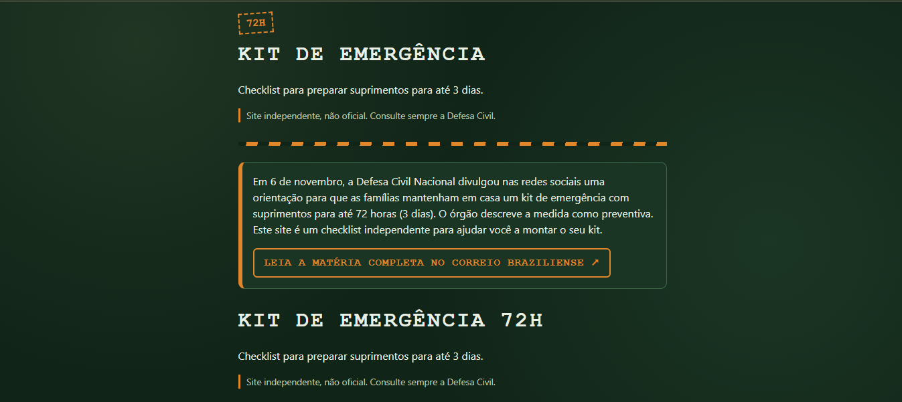

# 72-Hour Emergency Kit Checklist

An independent, mobile-friendly web checklist that helps families prepare a 72-hour (3-day) emergency kit, based on the recommendation published by Brazil's National Civil Defense (*Defesa Civil Nacional*).

Built with plain HTML, CSS and JavaScript. No frameworks, no build step, no backend.

   

**Live demo:** [victtorselva01.github.io/kit-72h](https://victtorselva01.github.io/kit-72h/)

---

## Table of contents

- [Motivation](#motivation)
- [Features](#features)
- [Tech stack](#tech-stack)
- [Project structure](#project-structure)
- [Running locally](#running-locally)
- [Design and engineering decisions](#design-and-engineering-decisions)
- [Accessibility and responsiveness](#accessibility-and-responsiveness)
- [What I learned](#what-i-learned)
- [Limitations](#limitations)
- [Roadmap](#roadmap)
- [Sources and disclaimer](#sources-and-disclaimer)
- [Author](#author)

---

## Motivation

In November 2026, Brazil's National Civil Defense published guidance on social media recommending that families keep an emergency kit at home with supplies for up to 72 hours. The topic quickly drew public attention, and information about it was spread across many news articles.

I wanted to turn that guidance into something practical: a simple, interactive checklist that people can open on their phone, tick off item by item, and come back to later. The project is also a hands-on exercise in building a small but complete web application with clean structure, sensible data modeling and attention to accessibility.

## Features

- **Categorized checklist** covering water and food, health and hygiene, energy and communication, and documents and contacts.
- **Persistent progress.** Checked items are saved in the browser, so the list is still there when the user comes back.
- **Progress bar** with a live counter (for example "5 of 12 items") and a completion message.
- **Per-person water calculator.** The user enters the number of people in the household and the recommended amount of water is calculated automatically (2 liters per person per day, 6 liters per person for 3 days).
- **Intro text and source links** so users can read the original coverage and verify the information.
- **Themed, responsive design** with a jungle-green, survival-inspired look that works on small screens.
- **Works offline-friendly and lightweight**: a single page, no external dependencies, no network requests after load.
- **Food ideas.** An expandable section with non-perishable food suggestions, clearly labeled as the site's own suggestions rather than official guidance.

## Tech stack

| Layer | Technology |
| --- | --- |
| Structure | HTML5 (semantic elements) |
| Styling | CSS3 (custom properties, flexbox, gradients, `:has()` selector) |
| Behavior | Vanilla JavaScript (ES6+) |
| Persistence | Browser `localStorage` |
| Tooling | Git, VS Code, Live Server |

## Project structure

```
kit-72h/
├── index.html   # Page structure and static content
├── style.css    # Theme, layout and component styles
├── script.js    # Data, rendering, persistence and interaction logic
└── README.md
```

`script.js` is organized in clearly separated sections: data, storage helpers, progress logic, quantity calculation, and rendering.

## Running locally

No installation is required.

```bash
git clone https://github.com/victtorselva01/kit-72h.git
cd kit-72h
```

Then either open `index.html` directly in a browser, or serve the folder with any static server. With VS Code, the **Live Server** extension works well: right-click `index.html` and choose *Open with Live Server*.

## Design and engineering decisions

**1. Data is separated from rendering.**
The checklist content lives in a plain array of category objects at the top of `script.js`. The rendering function reads that data and builds the DOM. Adding, removing or reordering items means editing data only, not logic. This also makes it easy to load the data from a JSON file or an API in the future.

**2. Stable item IDs.**
Every item has a fixed `id` (for example `"agua"` or `"power-bank"`). Saved progress is keyed by ID, not by text or position, so editing a label or reordering the list never corrupts the progress of returning users.

**3. Derived state instead of duplicated state.**
The number of completed items is never stored. It is calculated from the saved progress object and the current item list every time it is needed. This keeps a single source of truth and avoids values drifting out of sync. Counting from the current item list (rather than from the stored object) also means removed items left in old saved data do not inflate the count.

**4. Optional per-person quantities and no invented data.**
Items can carry an optional `porPessoa` (per person) property. It is set only where there is a published source for the number: water, at 2 liters per person per day. Items without a sourced quantity simply show no number. Absence of data is modeled explicitly instead of being filled with a guess, which matters for a site that gives safety-related guidance.

**5. Defensive handling of user input.**
The household size field is never trusted. Empty values, negative numbers, text and very large numbers are normalized to a valid range (1 to 20). The `input` event updates the result as the user types, and the `change` event corrects the visible value when the field loses focus.

**6. Graceful degradation of storage.**
All `localStorage` access is wrapped in `try/catch`. If storage is unavailable (for example in restrictive private modes) or the saved data is corrupted, the app falls back to defaults and keeps working instead of crashing.

**7. Generic storage helpers.**
`carregar(key, fallback)` and `salvar(key, value)` work for any key. When a second piece of state (the number of people) was needed, the existing helpers were generalized instead of duplicated.

**8. Safe DOM construction.**
Elements are created with `createElement` and `textContent` rather than `innerHTML`, so text is never interpreted as HTML.

**9. Targeted DOM updates.**
References to the elements that display quantities are kept in an array, so changing the household size updates only those text nodes. The page is not re-rendered, which preserves the state of the checkboxes and keeps updates cheap.

**10. Theming with CSS custom properties.**
The color palette is defined once on `:root` and reused everywhere. Changing the theme means editing a few variables. Visual details (hazard-stripe header border, camouflage-like background, stencil-style headings) are done in pure CSS with gradients and pseudo-elements, with no image assets.

## Accessibility and responsiveness

- Native form controls (`<input type="checkbox">`, `<input type="number">`, `<progress>`) keep built-in semantics and keyboard support.
- The progress text uses `aria-live="polite"` so assistive technologies announce changes.
- Links use descriptive text and open with `rel="noopener noreferrer"`.
- Interactive elements have visible keyboard focus styles (`:focus-visible`).
- Light text on a dark green background keeps strong contrast for reading in stressful or low-light situations.
- A viewport meta tag, a constrained content width and a numeric keyboard hint (`inputmode="numeric"`) make the page comfortable on phones.
- The progress bar is sticky, so progress stays visible while scrolling.

## What I learned

- Structuring a small project so that data, storage, state calculation and rendering each have a clear place.
- Using the DOM API and the event model (`change`, `input`) to build interactive behavior without a framework.
- Persisting state with `localStorage` safely, including parsing, fallbacks and key design.
- Why derived state is more reliable than duplicated state.
- Validating and normalizing user input.
- Modern CSS: custom properties, `:has()`, pseudo-elements, gradients and `position: sticky`.
- Debugging with browser DevTools: the Network tab to find files that fail to load, the Application tab to inspect stored data, and the Console for runtime errors.
- Working with Git from the terminal on a small project, with incremental commits per feature.
- Writing about a safety-related topic responsibly: citing sources, avoiding alarmist wording and not publishing numbers that cannot be backed up.

## Limitations

- Progress is stored only in the browser of the device in use. It is not synced across devices, and clearing browser data removes it.
- Only water has a calculated quantity, because it is the only per-person figure found consistently in reporting of the official recommendation. Other items are checklist entries without quantities.
- The checklist content is based on press coverage of the official guidance, and the original social media post could not be verified directly while building the project. Guidance may also differ between states and municipalities.
- The interface is currently in Portuguese only.
- There are no automated tests yet. Behavior has been verified manually in the browser.

## Roadmap

- [ ] Deploy to GitHub Pages
- [ ] Profile-based items (infants, older adults, pets), each backed by an official source
- [ ] "Last reviewed" date and reminders to check expiration dates
- [ ] Language switcher (Portuguese and English)
- [ ] Print-friendly stylesheet and PDF export
- [ ] Installable offline version (PWA)
- [ ] Basic automated tests for the storage and calculation logic

## Sources and disclaimer

This is an **independent project and is not affiliated with or endorsed by any government agency**. It is an organizational aid, not official guidance. Always follow the instructions and alerts of the Civil Defense of your municipality or state.

- National Civil Defense on Instagram: [@defesacivilbra](https://www.instagram.com/defesacivilbra/)
- Press coverage: [Defesa Civil explica recomendação de kit de emergência para 72 horas (Correio Braziliense)](https://www.correiobraziliense.com.br/brasil/2026/11/7534982-defesa-civil-explica-recomendacao-de-kit-de-emergencia-para-72-horas.html)

## Quality

Lighthouse scores (mobile): Performance 84, Accessibility 100, Best Practices 100, SEO 100.

## Author

**Victor**

- GitHub: [victtorselva01](https://github.com/victtorselva01)
<!-- Add your LinkedIn link here -->

## License

_Choose a license (for example MIT) and add a `LICENSE` file, then mention it here._
